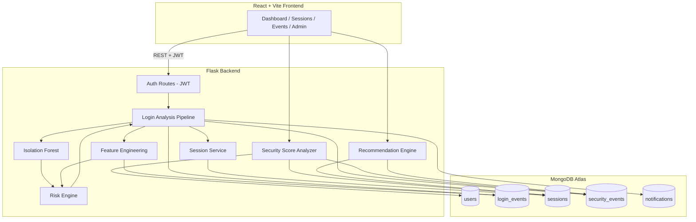

# ATO Shield — Architecture

## Request flow: a single login attempt

1. Frontend collects `device_id` (stable per-browser fingerprint), `device_name`, and a `location` string, and posts them with the credentials to `POST /api/auth/login`.
2. The backend verifies the password, then calls `analyze_and_record_login`, which:
   - Pulls the user's login history from MongoDB to compute features (`feature_engineering.py`).
   - Scores those features with the persisted Isolation Forest model (`anomaly_detector.py`).
   - Combines the ML signal with rule-based weights into a 0–100 score, level, and action (`risk_engine.py`).
   - Persists a `login_events` document, creates a `sessions` document (if allowed), and — for MEDIUM/HIGH risk — a `security_events` document plus a notification.
3. If the action is `BLOCK`, the API returns 403 and no session is created.
4. The frontend dashboard reads `security-score`, `security/events`, `security/recommendations`, and `security/timeline` to answer: *Am I safe? What happened? Why? What should I do?*

## Why these technology choices

- **MongoDB** — login/security events carry variable metadata (reasons lists, related IDs, feature snapshots) that map naturally onto documents rather than a fixed relational schema.
- **Flask** — a lightweight Python backend that integrates directly with the same `scikit-learn`/`joblib` model artifacts used for training, with no serialization boundary between ML and API code.
- **Isolation Forest** — this is an anomaly-detection problem with very little labelled attack data available; Isolation Forest doesn't require labelled anomalies to train and naturally scores "how isolated" a data point is versus the learned normal distribution.
- **Rules alongside ML** — rules catch known, well-understood patterns (e.g., "N failed attempts in a row") with a clear, explainable reason. ML catches things a static rule wouldn't anticipate. Neither is used alone to make a blocking decision.
